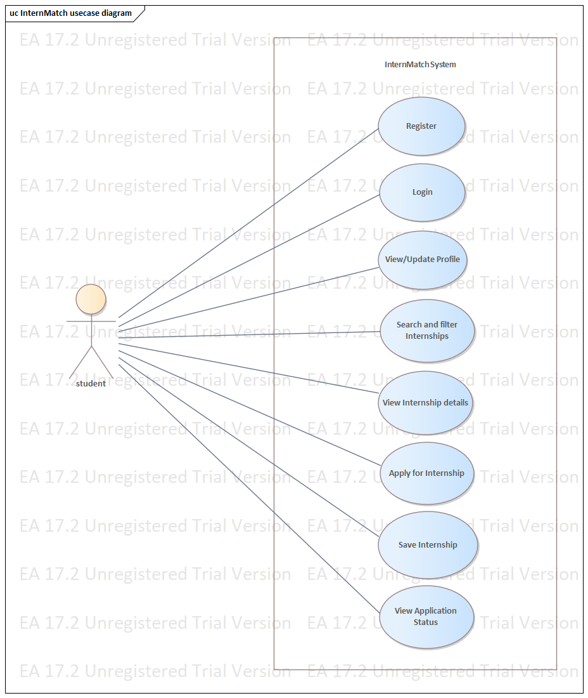
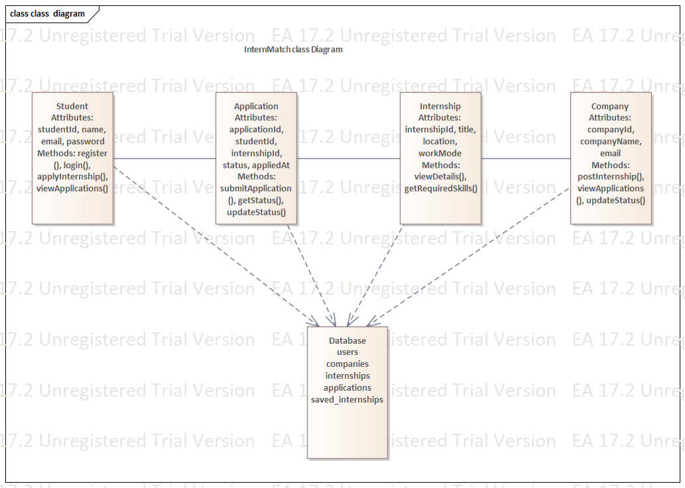

# InternMatch – Smart Internship Platform

## Live Website
🔗 https://internmatch-wmt8.onrender.com/

## GitHub Repository
🔗 https://github.com/Lavanya1109-codes/InternMatch

## Project Overview
InternMatch is a web-based platform that helps students discover internship opportunities, apply online, save internships, and track their application status.

## 1. Scrum Master Responsibilities
- Organize sprint planning meetings.
- Help the team understand sprint goals.
- Track progress and identify blockers.
- Encourage team communication.
- Facilitate sprint reviews and retrospectives.
- Support continuous improvement.
  
## 2. Product Backlog

| ID | Feature | Priority | Status |
|---|---|---|---|
| PB01 | Student registration and login | High | Completed |
| PB02 | Browse internship opportunities | High | Completed |
| PB03 | Apply for internships | High | Completed |
| PB04 | Save internships | Medium | Completed |
| PB05 | Track application status | High | Completed |
| PB06 | Company/recruiter login | High | Planned |
| PB07 | Company application dashboard | High | Planned |
| PB08 | Skill-based internship matching | Medium | Planned |
| PB09 | Interview notifications | Medium | Planned |

## 3. Sprint Planning

### Sprint 1 – Setup and Authentication
- Set up frontend, backend, and database.
- Implement student registration and login.

### Sprint 2 – Internship Management
- Display internship opportunities.
- Implement saving and browsing internships.

### Sprint 3 – Applications
- Implement the Apply feature.
- Store applications in MySQL.
- Display application status.

### Sprint 4 – Testing and Deployment
- Test frontend and backend integration.
- Verify database connectivity.
- Deploy the application using Render.

## 4. Team Collaboration
- Divide tasks among team members.
- Communicate progress and discuss problems.
- Use GitHub to manage source code.
- Review changes and integrate modules.
- Test the application collaboratively.

## 5. Task Tracking

| Task | Status |
|---|---|
| Frontend development | Completed |
| Backend API development | Completed |
| Database integration | Implemented; testing required |
| Student authentication | Implemented; testing required |
| Application workflow | Implemented; testing required |
| Deployment | Deployed |
| Company dashboard | Planned |

## 6. Technology Stack
- **Frontend:** HTML, CSS, JavaScript
- **Backend:** Node.js and Express.js
- **Database:** MySQL
- **Authentication:** JWT and bcrypt
- **Version Control:** GitHub
- **Deployment:** Render

## 7. Future Enhancements
- Company/recruiter login and dashboard.
- Recruiter access to student applications.
- Skill-based internship matching.
- Interview scheduling and notifications.

## UML Diagrams

### Use Case Diagram

### Class Diagram

